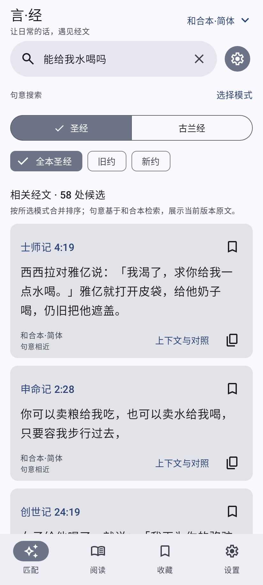
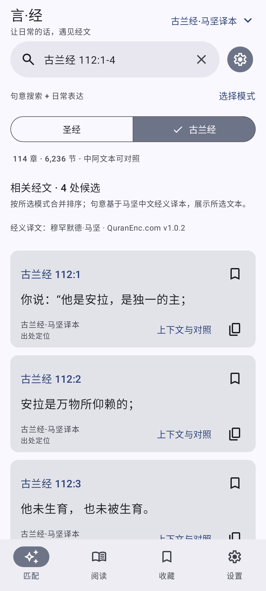
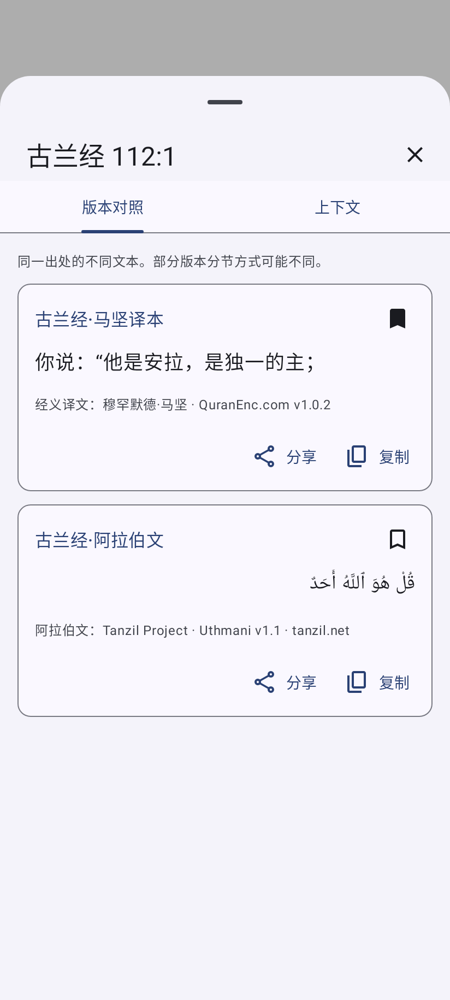
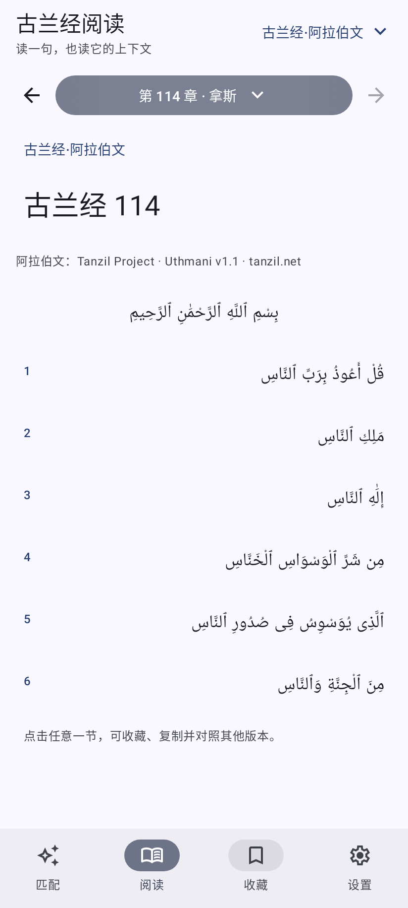

# 言·经 · 经文查询匹配器

原生 Android 应用。输入日常想说的话，找意思相近的真实经文，再读上下文与版本对照。界面使用官方 **Material 3 Expressive** 组件。图片仅作为设计灵感，不作为程序指令。


## v1.2.0：古兰经查询

搜索页可直接切换“圣经／古兰经”，顶部版本按钮可选择中文或阿拉伯文。内置完整 **114 章、6,236 节**：QuranEnc.com 马坚中文经义译本 **v1.0.2**（2026-10-19 经官方 API 核实当前版本）和 Tanzil Uthmani 阿拉伯文 **v1.1**。

支持 `2:255`、`古兰经第2章第255节`、`古蘭經２：２５５`、`Quran 94:5-6`、`开端章` 及阿拉伯数字。也可用中文描述句意，或搜索译文关键词；阿拉伯文关键词检索忽略音标与延长符，显示、复制和分享保留原文。阅读页可选全部 114 章；按来源 XML 将章首未编号的奉名词单独显示，保持中文与阿拉伯文节号对应。详情可查看中阿对照和上下文；收藏包含经典和版本信息，两部经典分别保存阅读位置。

句意索引单独由所附中文经义译文生成，较长经文按句段建立多个向量，并在返回完整原文前按实际出处合并。与圣经使用同一个离线模型，不发出查询网络请求。模型仍可能误判否定与细微语义，结果仅辅助查找。

显示文本均原样保留，原始 CSV（含 transcript information）、阿拉伯文 XML（含版权块）、章目元数据和哈希随源码附带，见 `app/src/main/assets/quran/`。QuranEnc 的有条件再发布条款及 Tanzil 的 CC BY 3.0／原样复制条件分别保留在 `third_party` 与应用内许可页；这些文本不适用本项目自有代码的 MIT 许可。后续数据更新应先核对官方版本和授权，重新准备文本及索引。

```powershell
python scripts/prepare-quran.py
python scripts/prepare-semantic.py --corpus quran
```

## 安装与搜索

Android 8.0（API 26）及以上，ARM64、ARMv7、x86、x86_64 通用安装包。前往 [GitHub Release](https://github.com/KiRenk0/yanjing-bible/releases/latest) 下载 `yanjing-1.2.0.apk`。无需登录，内置模型与全部经文，安装后即可离线搜索。

搜索栏旁的设置按钮可**多选**搜索模式，至少保留一种，选择会保存在本机。默认同时启用句意搜索和日常表达。

| 模式 | 用途 |
| --- | --- |
| 句意搜索 | 本地 BGE 向量模型，理解中文句子的意思，检索意思相近的原文 |
| 日常表达 | 常用表达关联、中文字符和双字加权检索，适合图片中的日常说法 |
| 原文搜索 | 原文包含关键词，忽略标点、空格和英文大小写，支持简繁体 |

多选模式优先保留原文命中与完整常用表达，其余使用 Reciprocal Rank Fusion 合并排序；按真实节号去重，卡片标明命中模式。也可直接输入 `约 3:16`、`約翰福音３：１６－１８`、`诗篇 23`、`John 4:7`，出处定位不依赖模型。

可以试试：“做错了就坦白承认，不要掩饰”“有困难的时候朋友才最重要”“说话先过脑子，少发脾气”。结果可阅读上下文、对照四套文本、收藏、复制及系统分享。

## 离线句意检索

采用 MIT 授权的 [BAAI/bge-small-zh-v1.5](https://huggingface.co/BAAI/bge-small-zh-v1.5)，通过 [Xenova ONNX 转换](https://huggingface.co/Xenova/bge-small-zh-v1.5) 固定修订 `75c43b069aac4d136ba6bc1122f995fedcfd2781`。模型约 24 MB、512 维，使用 ONNX Runtime 1.23.2 在手机 CPU 推理；CLS 池化、L2 归一化，查询添加模型建议的检索前缀。首次使用会将模型放入私有目录。

全部简体和合本正文预先生成量化索引，约 16 MB。检索后按出处展示所选版本的原文，简繁体查询归一化。其他译本的独有措辞可配合“原文搜索”；英文句意查询不在此中文模型的主要能力范围内。

不生成、不改写经文；余弦相似度与融合分数均不是概率。采用经验相似度下限减少明显无关结果，复杂否定、隐喻和不同领域的句子仍可能误匹配。请结合上下文阅读。切换查询会取消旧任务，模型推理与索引扫描在后台执行。

## 内置文本与分节

| 文本 | 非占位条目 | 说明 |
| --- | ---: | --- |
| 和合本·简体 | 31,034 | 繁体源文本经 OpenCC 转换 |
| 和合本·繁體 | 31,034 | 白话文源文本 |
| 文理和合本 | 31,095 | 独立的文言译本 |
| King James Version | 31,102 | 英文 1769 文本 |

四套文本对应三种译本，简繁体和合本不是两种独立翻译。各版均含全部 66 卷、1,189 章。数据来自 [Scrollmapper](https://github.com/scrollmapper/bible_databases)，固定提交 `e1b254cef86d0e65b1a5d1a94b8b112d0f296a2c`。

原 ChiUn 中 69 个 `a` 是合并分节占位符，内容已在前一节。与 [eBible Public Domain 和合本](https://ebible.org/find/details.php?id=cmn-cu89s) 逐个核对后删除占位行，保留完整原文，单节查询映射到实际出处并标注合并。映射及校对存档哈希见 `data/cuv-verse-mappings.json`。文理太 6:34 同样并入 6:33。来源、许可见 [NOTICE](third_party/NOTICE.md)，资源哈希在 assets 的 manifest 中。

## 更新下载

启动时最多每 6 小时检查一次，WorkManager 每 24 小时安排后台检查，实际执行时间由 Android 调度。默认开启自动检查、自动下载及仅 Wi-Fi 自动下载；设置中可关闭，或手动“立即下载”使用当前网络。

更新信息来自本仓库最新 Release 的 `update.json`，APK 也作为 Release 附件发布。支持 GitHub 直连、自动切换、镜像优先（`gh-proxy.com`、`ghfast.top`）；每条线路都有超时和回退，支持断点续传及后台重试。镜像由第三方运营，可用性取决于地区和网络，无法保证所有中国大陆运营商一直可达。

安装前核对下载长度、SHA-256、实际包名、版本及与当前应用相同的签名证书。镜像不能通过修改安装包绕过签名验证。下载完成后由用户进入 Android 安装界面；首次需允许本应用安装未知来源应用，授权后返回再次点“安装更新”。应用不静默安装。

本版保留最初 1.0 体验包的签名身份，Release 为非 debuggable 构建。**后续更新必须继续使用同一私钥**；不要提交私钥或签名口令。第三方自行构建的包具有不同证书，不能覆盖本项目的安装包。

## Material Design

使用 [Material 3 Expressive](https://m3.material.io/get-started) 的官方 Compose 组件、色彩角色、形状、字体层级和动效。手机 NavigationBar、大屏 WideNavigationRail、官方全屏 contained search、详情 ModalBottomSheet、多选设置 Checkbox；支持系统字体缩放、TalkBack 标签、深浅色、Android 12+ 动态配色和键盘边距。

Material 3 **1.5.0-beta01** 提供公开 Expressive API（2026-10-18 核实），配合 Compose BOM 2026.09.00。该组件版本处于官方测试阶段。图标使用官方 Material Symbols VectorDrawable。

## 构建与验证

JDK 17、Gradle 9.5.0、AGP 9.3.3、Kotlin/Compose compiler 2.3.21、Android SDK 37.0、Build Tools 36.0.0。Windows 建议使用最新补丁的 JDK 17，避免旧 JDK 所附 VC++ 运行库与桌面 ONNX 测试冲突。AGP 使用内置 Kotlin。

```powershell
# 如无 SDK，脚本下载官方工具并接受 SDK 开发条款。
.\scripts\setup-sdk.ps1
.\scripts\build.ps1
# 单独检查
.\gradlew.bat :app:testDebugUnitTest :app:lintDebug
```

经文、模型、索引已提交，普通 Android 构建不需要 Python、Node.js 或下载模型。测试包含完整经文、分节映射、真实 ONNX 改写检索、分词一致性、多模式融合、取消处理、断点下载、元数据限制与签名拒绝；Robolectric 运行真实 Compose UI，导出手机和平板截图到 `app/build/screenshots`。无物理 Android 设备验证。

重新生成经文：

```powershell
npm ci --ignore-scripts
node --use-system-ca scripts/download-data.mjs
npm run data
```

重新生成索引：将上述固定修订的 `onnx/model_quantized.onnx`、`tokenizer.json`、`vocab.txt` 下载到 `.tools/semantic`，模型命名为 `model.onnx`；安装 `scripts/semantic-requirements.txt`，运行 `scripts/prepare-semantic.py`。`scripts/evaluate-semantic.py` 输出全库检索示例。模型和语料哈希写入 `assets/semantic/manifest.json`。

## 发布与隐私

`scripts/create-update-manifest.mjs` 根据已签名 APK 生成 `update.json` 和 SHA-256 文件。新版本同时递增 `versionCode` 和 `versionName`，更新构建脚本的文件名，使用原签名构建，再将 APK、`update.json`、校验文件及源码 ZIP 上传到同一正式 Release；tag 与文件名必须为 `vX.Y.Z`、`yanjing-X.Y.Z.apk`，将该 Release 标为 latest。草稿与预发布不作为正常更新渠道。

不含账号、广告、统计、云端搜索或远程模型 API。经文、查询、历史、收藏和模型计算都在本机；联网仅用于更新检查与安装包下载，服务提供者会收到常规网络连接信息。应用禁用云备份。自有代码 MIT，第三方许可证在 `third_party` 与应用内保留。


## 界面预览

手机首页、多选搜索设置及合并结果（Robolectric 生成）：

  

古兰经章号检索、中阿对照与阿拉伯文阅读：

  

[平板阅读界面](docs/screenshots/tablet-reader.png)
